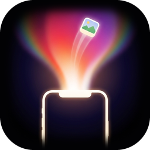

<p align="center"></p>
<h1 align="center">Flare</h1>
<p align="center">Flick a file off your phone and it lands on your computer’s desktop.</p>

Hold your phone next to your computer, press and hold, and the two light up
together. Then press and hold any photo or file on your phone and flick it
upward: a burst of light rolls across your computer’s screen and the file lands
on the desktop. No account, no cloud, nothing leaves your Wi‑Fi.

## Download

Grab the newest build from the **[Releases](../../releases/latest)** page.

| Device | File |
| --- | --- |
| **Android** phone | `Flare-<version>-android.apk` |
| **iPhone** | Not on the App Store yet. See *iPhone* below. |
| **macOS** (Apple Silicon) | `Flare-<version>-arm64.dmg` |
| **Windows** 10 / 11 (64‑bit) | `Flare-Setup-<version>-win-x64.exe` (installer) or `Flare-Portable-<version>-win-x64.exe` (no install) |
| **Linux** | `Flare-<version>-linux-x86_64.AppImage` or `Flare-<version>-linux-amd64.deb` (Intel/AMD) · `…-arm64.AppImage` / `…-arm64.deb` (ARM) |

## Install

**Android** — open the `.apk` on your phone and allow installing from this
source if asked. Flare asks for nothing but the local network.

**iPhone** — the iOS build has to go through Apple. Until it is on TestFlight,
you can run it with the free [Expo Go](https://apps.apple.com/app/expo-go/id982107779)
app: ask the developer for the project link, or build it yourself with Xcode.

**macOS** — open the `.dmg` and drag Flare to Applications. The build is not
notarised yet, so the first time macOS will say it “cannot be opened”.
Right‑click Flare → **Open** → **Open**, once. Or run:

```bash
xattr -dr com.apple.quarantine /Applications/Flare.app
```

Flare lives in the menu bar (the little phone‑with‑a‑flare icon).

**Windows** — run the installer. SmartScreen may show “Windows protected your
PC” because the build is not code‑signed: click **More info → Run anyway**.
Flare lives in the system tray.

**Linux** — `chmod +x Flare-*.AppImage && ./Flare-*.AppImage`, or
`sudo dpkg -i Flare-*.deb`. Flare lives in the system tray.

## Use it

1. Open Flare on the computer. Note its name in the window that appears.
2. Open Flare on the phone. It finds the computer by itself:
   **“Hold phone next to <Your Computer>”**. The computer’s screen edge lights
   up as the phone comes near.
3. **Press and hold** the white circle. Click **Allow** on the computer. Both
   screens bloom white — you are connected (the phone remembers it).
4. Tap **+** to put photos or files on the shelf.
5. **Press and hold** a file, then **flick it up**. It dissolves into light on
   the phone and lands top‑right on the computer’s desktop.

Files are saved to **Desktop** by default; change it in Flare’s window on the
computer, where you can also forget phones and pick which screen edge the light
comes from.

## Troubleshooting

- **No computer found** — both devices must be on the same Wi‑Fi, and Flare must
  be running on the computer. Some networks (hotels, campuses, guest Wi‑Fi)
  block devices from seeing each other: tap **Enter address** on the phone and
  type the address shown in Flare on the computer.
- **Windows firewall** asks on first launch: allow Flare on **private** networks.
- **Nothing lands** — the phone shows an error and puts the file back. Connect
  again from the **⋯** menu → *Change computer*.

## Price

Flare is **free for one day** on each computer. After that, one payment of
**$11.99** (via Polar) unlocks that computer forever: click **Unlock Flare** in
Flare on the computer (or in the menu bar / tray menu), pay, and paste the
license key from your receipt into Flare. One key works on up to 3 computers.

## Privacy

Everything goes phone → computer over your local network, directly. A phone can
only send after you click **Allow** on the computer, and you can forget it at any
time. Flare makes no network connections of its own.
